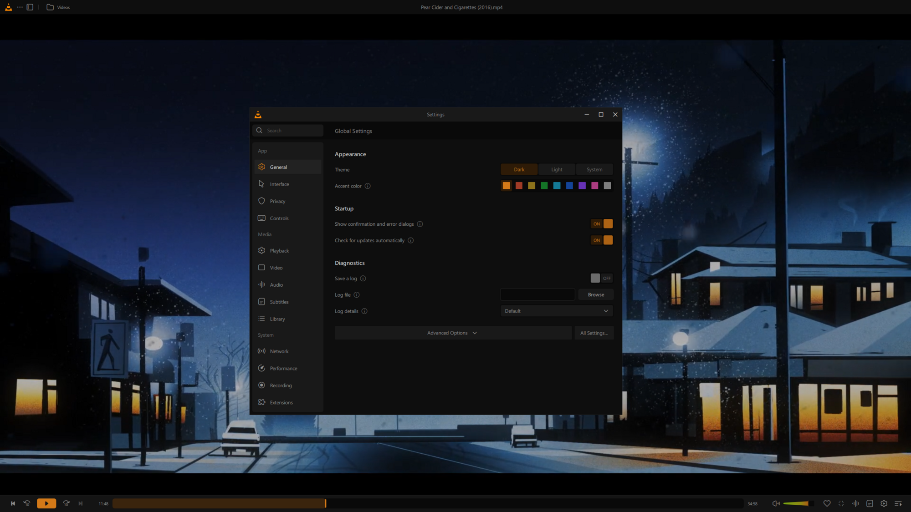

# VLC Redesign (unofficial)

A new interface for VLC media player 4.0, built on VLC's own Qt/QML interface and
following the community design "VLC Redesign" by Juxtopposed.

[](COPYING)
[](https://creativecommons.org/licenses/by/4.0/)
[](#download-and-install)

> [!IMPORTANT]
> This is an **unofficial fan project**. It is not made, affiliated with, or endorsed
> by VideoLAN. "VLC", "VLC media player" and the cone logo are trademarks of
> VideoLAN. This is a modified version of VLC, redistributed under the GNU GPL like
> VLC itself; the original software comes from
> [videolan.org](https://www.videolan.org/) and
> [code.videolan.org/videolan/vlc](https://code.videolan.org/videolan/vlc).
> Please do not report problems with this build to VideoLAN.

It is based on VLC master (4.0 development version, commit `1176b56`). The work is in
the Qt interface (`modules/gui/qt`), plus a few small changes elsewhere listed in
[CHANGELOG.md](CHANGELOG.md). The original VLC README is in
[README.upstream.md](README.upstream.md).

## Screenshots

| Player | Settings |
|:---:|:---:|
|  |  |
| Library home | Seek bar preview |
|  |  |

## Features

What is in the code today.

**Look and feel**
- Colours, accent (#D37918, user-selectable), icon set and two-tone menu icons from the design
- Restyled menus, dialogs and top bars; new placeholder pictures for media without artwork
- Onboarding on first start: media folder, theme and accent colour, basic shortcuts

**Player**
- One-row player bar: playback controls on the left, a thick seek bar in the middle
- On the right: Favorite, the cone-shaped volume, fullscreen, Audio, Subtitles, Playback
  settings and Queue
- Rounded frame around the video
- Top bar with the media title, the folder name (opens the library at that folder) and a
  library button; with VLC's own title bar: minimize, maximize, close
- Favorite button for every media, also for files outside the library
- Audio / subtitle track popover; Queue / Bookmarks / Chapters popover with sort,
  repeat, shuffle, add and remove
- "Continue watching" prompt with the time already watched; error messages in the same style
- Right-click menu reorganized like the design, with "Hide UI"
- Default hotkeys changed: Record is `R` (Random has no key), Hide UI is `Ctrl+\`

**Seek bar**
- Preview thumbnails while hovering (local video files)
- Subtitle timeline on the seek bar with delay and zoom buttons (external .srt, .vtt,
  .ass, .ssa files; turned on in the Playback tab)
- Waveform for local audio files

**Playback settings panel** (gear button)
- Playback, Video, Audio and Subtitles tabs: speed, reverse, sleep timer; video effects
  (essential, crop, colours); equalizer with preset icons, compressor, spatializer,
  stereo widener; audio and subtitle delays
- Subtitle appearance: font, colours, offset, size as named steps or as a percentage,
  outline thickness, background opacity, and saved subtitle presets
- "Open Advanced Settings" opens the matching page of the settings window

**Library**
- Side navigation: Home, Videos, Music, Network, Playlists, Recent, pins and "Add item";
  icon-only rail with side panels on narrow windows; back and forward in the page headers
- Home: Continue Watching, Listen Again, Frequently Visited Folders; "Remove from Home"
  in the context menu; music covers from the files' artwork
- Videos browsed by library folder with previews of what is inside; Music with Songs,
  Albums, Artists and Genres
- Network: Add Network Stream, Podcasts, Radio (bundled country flags), saved streams
- Folder and file context menus (play, queue, stream, convert, subtitle and audio tracks,
  resync, show in folder, pin, remove from library)
- Compact library panel inside the player (resizable); mini player card with the play queue

**Dialogs and settings**
- New settings window (App / Media / System, search, advanced options), backed by VLC's
  own options; equalizer with 10 bands and audio effects applied while playing
- Settings profiles (Movies, Shows, Music, Work, …): each keeps all settings, including
  the player bars, theme and subtitle presets
- Theme and accent colour change at once, also over a playing video; the accent replaces
  the orange everywhere, including the cone logo
- Open Network Stream, New Playlist (with picture), Playlist Properties, Keyboard Shortcuts
- Add Subtitles / Add Audio Tracks: to this file, folder or playlist; from the computer
  or from a link. Tracks are saved in the media library and loaded every time
- Customize Player edits the bars in place, for the video and the music player, with new
  bar items (Favorite, PiP, ±15 s, Chapters, Bookmark, Zoom, …)

## Download and install

### Windows (10 or 11, 64-bit)

Download from the [Releases](https://github.com/oliver-bacon/vlc/releases) page. You can
check a download against `SHA256SUMS.txt` from the same release:
`certutil -hashfile <file> SHA256`.

**Portable (recommended):** `vlc-4.0.0-dev-win64.zip` or `.7z`. Extract it anywhere and run
`vlc.exe`. Nothing is installed.

**Installer:** `vlc-4.0.0-dev-win64.exe`. This is VLC's own installer, unchanged: it calls
itself "VLC media player" and installs into the same folder as official VLC
(`C:\Program Files\VideoLAN\VLC`), **replacing an installed VLC** and its file
associations. Use it only if you do not need official VLC on the same PC; reinstall
official VLC from [videolan.org](https://www.videolan.org/) to go back.

Notes:
- The build is not code-signed, so Windows SmartScreen may warn before the first start.
- It uses the same settings folder as an installed VLC (`%APPDATA%\vlc`). If you also use
  official VLC 4 builds, back that folder up first.
- If you used an earlier build: open **Customize Player** and click **Restore Default**
  to get the new player bar.

### Linux

No Linux packages. Build from source (experimental), see [Linux (experimental)](#linux-experimental).

## Known issues

- **Testing:** tested by the author only; no independent tester yet.
- **Light theme:** not reviewed screen by screen.
- **Subtitle timeline:** works with external .srt / .vtt / .ass / .ssa files; embedded
  subtitle tracks get no timeline.
- **Not implemented:** subtitles from OpenSubtitles (shown but disabled); the key that was
  pressed in on-screen messages; picture-in-picture outside the main window; moving the
  seek bar in Customize Player.
- **UPnP shutdown hang on Windows:** VLC's UPnP plugin could keep `vlc.exe` running after
  closing, and the next start had no media library. This build includes a fix (libupnp
  miscompiled with MinGW). If it still happens: end `vlc.exe` in Task Manager and delete
  `plugins\services_discovery\libupnp_plugin.dll` (you lose UPnP discovery).

Please report problems in the [issue tracker](https://github.com/oliver-bacon/vlc/issues) of this repository.

## Building from source

### Windows (Docker, recommended)

From the repository root, with Docker (on Linux or in WSL):

```sh
docker run --rm -it --user root -v "$PWD":/vlc -w /vlc \
  registry.videolan.org/vlc-debian-win64-posix:20260611225331 \
  bash -c 'git config --global --add safe.directory /vlc && extras/package/win32/build.sh -a x86_64 -p -r -i r'
```

This uses VideoLAN's own build image. The first run takes long because it also builds
VLC's dependencies. Output: `win64/vlc-4.0.0-dev/vlc.exe` and the packages
`win64/vlc-4.0.0-dev-win64.zip` / `.7z` / `.exe`; debug symbols in
`win64/symbols-4.0.0-dev/`.

### Linux (experimental)

Tested on Arch Linux with the system Qt 6.12 and medialibrary 0.13.2 built from source.
It also builds on Ubuntu with Qt 6.8.3 from [aqtinstall](https://github.com/miurahr/aqtinstall)
(see the notes below).

**1. Install VLC's build dependencies.** On Arch:

```sh
sudo pacman -S --needed base-devel git meson ninja pkgconf cmake nasm \
  qt6-base qt6-declarative qt6-svg qt6-shadertools qt6-wayland qt6-5compat qt6-tools \
  ffmpeg libass libplacebo freetype2 fribidi harfbuzz fontconfig \
  libx11 libxcb xcb-util-keysyms xcb-util-renderutil libxkbcommon libxkbcommon-x11 libxinerama libxpm \
  wayland wayland-protocols mesa libglvnd libdrm libva libvdpau vulkan-headers vulkan-icd-loader \
  libpulse alsa-lib pipewire libsamplerate \
  libmatroska libebml taglib libvorbis opus flac libmad libmpeg2 a52dec libdca faad2 libtheora speex speexdsp \
  libdvbpsi libbluray libdvdnav libdvdread libarchive libnfs gnutls libgcrypt libsecret dbus \
  libjpeg-turbo libpng librsvg libupnp sqlite zlib zstd srt aribb24 libmodplug libmpcdec twolame lame \
  avahi libnotify gtk3 xorg-xwayland
```

On other distributions, install the same libraries under their own names (the development
packages, usually ending in `-dev` or `-devel`). A shortcut that covers most of them:

- Debian / Ubuntu: `sudo apt build-dep vlc` (needs the source repositories enabled)
- Fedora: `sudo dnf builddep vlc` (VLC is in RPM Fusion)

These install what the distribution's own VLC 3 needs, but not Qt 6: see the Qt note below.
VLC also needs meson 1.10 or newer, which most distributions don't have yet; install it with
pipx: `pipx install meson ninja`.

Only Qt 6 (with Qt Quick, Qt SVG and Qt ShaderTools) and medialibrary (step 2) are required.
Any other missing library only turns off the feature that uses it: `meson setup` lists each
dependency with `found: YES` or `found: NO`. To add a library later, install it and run
`meson setup --reconfigure build-linux`, then `ninja -C build-linux` again.

**2. Build medialibrary 0.13.2.** It is not packaged on most distributions. This uses the
same version and checksum as VLC's `contrib/src/medialibrary`, and applies this
repository's fix for a crash when quitting. Set `VLC_SRC` to your clone of this
repository; medialibrary is installed to `~/vlc-deps`:

```sh
VLC_SRC=$HOME/vlc
DEPS=$HOME/vlc-deps
curl -fLO https://code.videolan.org/videolan/medialibrary/-/archive/0.13.2/medialibrary-0.13.2.tar.bz2
echo "ec04cd28a19e547debf1a911fbcd33345a53a3f963e83d6f878c9836ebfefd4045c42a670a2c076ba3767bf91884f542e48dab6a254fc29285041fa9be35fe73  medialibrary-0.13.2.tar.bz2" | sha512sum -c -
tar xf medialibrary-0.13.2.tar.bz2
cd medialibrary-0.13.2
patch -p1 < "$VLC_SRC/contrib/src/medialibrary/0001-reset-logger-on-destroy.patch"
meson setup build --prefix="$DEPS" --libdir=lib --buildtype=release -Dlibvlc=disabled
ninja -C build install
cd ..
```

**3. Build VLC** from the repository root (in the same shell, so `DEPS` is still set):

```sh
PKG_CONFIG_PATH=$DEPS/lib/pkgconfig meson setup build-linux --buildtype=release \
  -Dmedialibrary=enabled -Dqt=enabled -Dlua=disabled \
  -Dc_link_args="-Wl,-rpath,$DEPS/lib" -Dcpp_link_args="-Wl,-rpath,$DEPS/lib"
ninja -C build-linux
```

**4. Run it** from the build folder. `VLC_LIB_PATH` is needed so that VLC finds its
modules and helpers such as the preparser:

```sh
VLC_LIB_PATH=build-linux/modules ./build-linux/bin/vlc-static -I qt
```

Notes:
- **Qt:** use Qt 6.8 or newer. The system Qt works on Arch (6.12). If your distribution has an
  older Qt (for example Ubuntu 24.04 and Debian 12 have 6.4), install Qt 6.8.3, the version VLC's
  Windows build uses, with aqtinstall: `aqt install-qt linux desktop 6.8.3 linux_gcc_64 -O ~/Qt -m qtshadertools`.
  Then prefix the `meson setup` command with `PATH=~/Qt/6.8.3/gcc_64/bin:$PATH` and add
  `~/Qt/6.8.3/gcc_64/lib/pkgconfig` to `PKG_CONFIG_PATH`
  (`PKG_CONFIG_PATH=$DEPS/lib/pkgconfig:$HOME/Qt/6.8.3/gcc_64/lib/pkgconfig`).
- **rpath:** the `-Wl,-rpath` link arguments let VLC find medialibrary in `~/vlc-deps`.
  Leave them out if medialibrary is installed system-wide.
- **Memory:** building needs about 8 GB of RAM with 6 parallel jobs; with less, use
  `ninja -C build-linux -j2`.
- **Virtual machines:** without GPU access, VLC logs Mesa / VA-API errors and falls back to
  software rendering; playback still works.

## Credits and attribution

**Design:** ["VLC Redesign"](https://www.figma.com/community/file/1691465999134370980/vlc-redesign)
by [Juxtopposed](https://www.juxtopposed.com/), licensed under
[CC BY 4.0](https://creativecommons.org/licenses/by/4.0/). See also the designer's
[redesign video](https://www.youtube.com/watch?v=ERFeOgqk324).

**Changes were made:** this repository is an independent implementation of that design
in VLC's Qt/QML interface. Some parts differ from the design, and some are not
implemented yet. Icons and pictures from the Figma file were used, converted or adapted
(see [CREDITS.md](CREDITS.md)). Juxtopposed is not involved in this project and has not
endorsed it.

**VLC:** the [VideoLAN team and VLC contributors](THANKS), who make VLC and its Qt interface.

**Redesign implementation:** Oliver Bacon ([@oliver-bacon](https://github.com/oliver-bacon)).

**Third-party assets:** country flags from [flag-icons](https://github.com/lipis/flag-icons)
(MIT). Details in [CREDITS.md](CREDITS.md).

## License

- **VLC**, including the Qt interface and this project's code changes, is under the
  [GNU GPL, version 2 or later](COPYING). **libVLC** (the engine in `src/` and `lib/`)
  is under the [GNU LGPL, version 2.1 or later](COPYING.LIB). The Windows builds contain
  GPL modules, so the program as a whole is distributed under the GPL.
- **The design** (and the icons and pictures taken from the Figma file, see
  [CREDITS.md](CREDITS.md)) is by Juxtopposed and licensed under
  [CC BY 4.0](https://creativecommons.org/licenses/by/4.0/), not the GPL.
- Country flags: MIT, see `modules/gui/qt/pixmaps/flags/LICENSE`.
